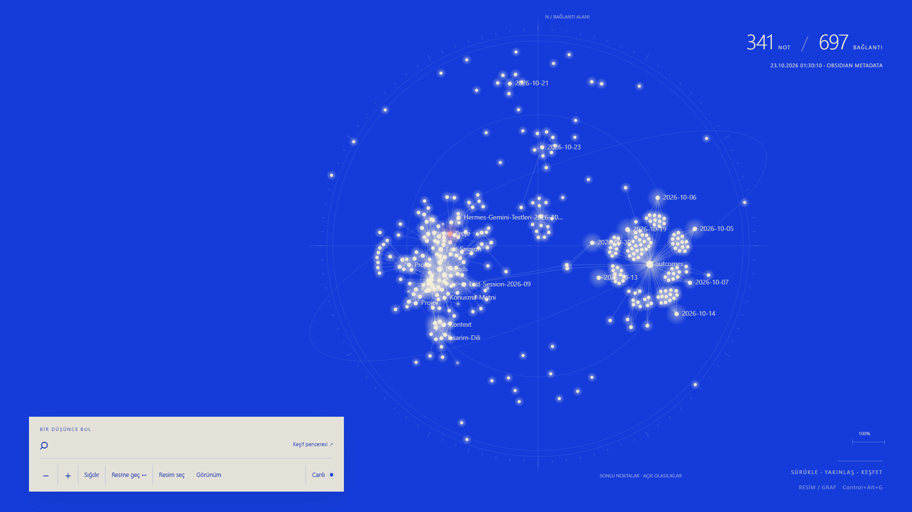

# Hafıza Duvar Kâğıdı



23 Ekim 2026 gerçek masaüstü görüntüsü. Görselde kişisel grafın not başlıkları bulunur; not gövdeleri gösterilmez.

23 Ekim düzeltmesi: bozuk görünürlük lease dosyası korunup doğrulanmış önceki yerel logdan kurtarıldı. Yeni lease yazımı disk flush ve bağımsız yedek kullanır; bozuk/kayıp ana dosya geçerli yedekten kurtarılır. Başlangıç değeri eksikse tahmin yapılmadan hata verilir. Host görünürlük yardımcısı kapanınca yeniden başlatır; graf açıkken Shell görünürlüğünü saniyede bir uzlaştırır. Fare köprüsü görünür SysListView32 katmanını geçer, Windows çift tıklaması korunur. Kanıtlar: `runtime/acceptance/visibility-regression.json`, `visible-icon-doubleclick.json`.

`tests/visibility-regression.ps1` kurtarma ve yeniden başlatmayı doğrular. `tests/visible-icon-doubleclick.ps1` geçici masaüstü kısayolunu gerçek Windows çift tıklamasıyla açıp kaldırır. Bu ikinci testte host önce `--debug --test-no-helper-watchdog` ile başlatılmalıdır; bayrak yalnız debug ile etkilidir. Test sonrası normal başlatıcıya dönülür.

Windows masaüstünde Obsidian bağlantı grafı ve fotoğraf arasında geçiş. **Lively yerine kendi Hafıza Desktop uygulaması** kullanılır: .NET 10 WinForms + Microsoft Edge WebView2, Explorer'ın WorkerW masaüstü katmanına yerleşir. Ücretli uygulama veya Lively gerekmez. Birincil monitör desteklenir.

## İlk kurulum

Windows 10/11 masaüstü, Node.js, .NET 10 SDK, Microsoft Edge WebView2 Evergreen Runtime ve Obsidian gerekir. Bu prototip mevcut Windows 11 cihazında doğrulandı; farklı Windows sürümleri için uyumluluk garantisi verilmez. Lively kurulumu gerekmez.

1. Projeyi vault dışında bir klasöre klonla. Bu klasörde `node server.js` çalıştır; ilk çalıştırma kişisel `runtime/config.json` ve rastgele token oluşturur. Konsolu açık tut.
2. `http://127.0.0.1:47831/` adresini aç. **Resim seç** ile kendi PNG/JPEG/WebP fotoğrafını yükle. Fotoğraf yüklenene kadar resme geçiş kullanılamaz; Windows arka plan resmi otomatik alınmaz.
3. `runtime/config.json` dosyasına `vaultName` alanını gerçek Obsidian vault adıyla ekle; diğer alanları ve üretilen token'ı koru. Alan yoksa prototip `CemoOS` adını kullanır.
4. Obsidian kapalıyken vault'un `.obsidian/plugins/hafiza-wallpaper` konumundan bu projenin `obsidian-plugin` klasörüne bir dizin junction'ı oluştur. PowerShell'de kendi tam yollarını kullan:

   ```powershell
   New-Item -ItemType Junction -Path 'D:\Vault\.obsidian\plugins\hafiza-wallpaper' -Target 'D:\Apps\hafiza-duvar-kagidi\obsidian-plugin'
   ```

   Hedef bağlantı konumu önceden mevcut olmamalı; `.obsidian/plugins` üst klasörü mevcut olmalı. Obsidian'da topluluk eklentileri altında **Hafıza Duvar Kâğıdı Bridge** eklentisini aç. İlk graf MetadataCache hazır olunca gönderilir. Ayrıntılar [eklenti kılavuzunda](obsidian-plugin/README.md).
5. İlk konsolu Ctrl+C ile kapat; `Start-Wallpaper.cmd` dosyasını aç veya PowerShell'de `./Start.ps1 -Wallpaper` çalıştır. Başlatıcı köprüyü gizli başlatır ve Windows yardımcılarını derler. İlk derleme NuGet erişimi gerektirir.

Çalışma zamanı dosyaları, fotoğraf, snapshot ve token bu depoda dağıtılmaz; her kurulumda yerel oluşur. Çalıştırmak için npm paketi gerekmez; testler için `npm ci`, tarayıcı testleri için ayrıca `npx playwright install chromium` kullanılır.

## Günlük kullanım

- `Start-Wallpaper.cmd`: gizli yerel köprüyü, kısayolu, simge görünürlüğü yardımcısını ve masaüstü uygulamasını başlatır. İkinci kez açmak ikinci uygulama oluşturmaz.
- `Stop-Wallpaper.cmd`: masaüstü uygulamasını ve yardımcılarını kapatır; başlangıçtaki simge görünürlüğünü geri yükler. Obsidian bağlantısının köprüsü açık kalır.
- **Ctrl+Alt+G**: graf/fotoğraf geçişi. Normal uygulamalardayken de çalışır.
- Graf üzerinde düğüme tıkla, düğümü veya boş alanı sürükle. Tekerlek/touchpad ve +/− yakınlaştırır. **Sığdır** görünümü sıfırlar.
- Arama, klavye ve dosya seçimi için **Keşif penceresi ↗** veya <http://127.0.0.1:47831/>. Masaüstü ana klavye odağını almaz.

PowerShell karşılığı: `./Start.ps1 -Wallpaper`. Yalnız köprü/yardımcılar: `./Start.ps1`. Hatalar `runtime/desktop-host.log`, `runtime/desktop-build.log`, `runtime/server-error.log` içinde. İlk açılış .NET SDK ile derler; WebView2 Evergreen runtime gerekir (bu cihazda kurulu). Otomatik Windows başlangıcı kurulmaz.

## Masaüstü davranışı

Graf modunda simgeler gizlenir; fotoğraf geçişi tamamlanınca önceki politika uygulanır. Simge boyutu ve konumları değiştirilmez. `windows/Stop-DesktopVisibility.ps1` başlangıç görünürlüğünü kurtarır; köprü veya wallpaper kapanınca da otomatik geri yüklenir. Explorer yeniden başladığında host masaüstü katmanına tekrar bağlanmayı dener; katman bulunamazsa normal pencere açmak yerine kapanır.

Explorer'ın DefView katmanı duvar kâğıdı tıklamalarını kapattığından, host yalnız birincil masaüstündeki graf sol fare olaylarını WebView2'ye iletir. Diğer uygulama ve taskbar olayları ile fotoğraf modu normal Windows davranışını korur. Klavye hook'u yoktur. Mevcut ayrı wheel yardımcısı yalnız aktif wallpaper masaüstünde yakınlaştırmayı ve Ctrl+wheel simge boyutu korumasını yapar. Sağ tık Windows menüsüne bırakılır.

Sahne fotoğraf modunda veya hareket kapalıyken sürekli çizim yapmaz. Bu ilk host sürümü başka uygulamalar masaüstünü örttüğünde otomatik performans duraklatması uygulamaz; **Canlı** düğmesiyle hareket kapatılabilir. Tam ekran ve çoklu monitör davranışı ayrıca ürünleştirilmemiştir.

## Veri ve ayarlar

Obsidian eklentisi `.obsidian/plugins/hafiza-wallpaper` junction'ıyla `obsidian-plugin/` klasörünü kullanır. MetadataCache değişiklikleri 700 ms debounce ile yalnız loopback köprüye gider; Obsidian kapalıyken `runtime/snapshot.json` korunur. Not gövdeleri okunmaz veya sunulmaz. Graf konumları ayrı saklanır.

Görünüm panelinde palet, not/klasör renkleri ve hareket ayarlanır; `runtime/appearance.json` içinde kalıcıdır. Resim PNG/JPEG/WebP olabilir. `runtime/config.json` içindeki kısayol değişince kısayol yardımcısını yeniden başlat. Token'ı paylaşma. Sunucu 127.0.0.1 dinler; Host/Origin ve yazma token denetimi vardır. Dış CDN yoktur; yerel kişisel `runtime/` Git dışında tutulur.

## Doğrulama

`npm test`: HTTP ve veri sınırı testleri. `node tests/browser.cjs`: mevcut sahne kabulü. `windows/Start-Desktop.ps1 -DebugHost` ile yalnız test için 47832 loopback CDP açılır. `node tests/native-host.cjs` gerçek WebView sayfasını ve wallpaper bağlantısını doğrular. `node tests/native-pointer.cjs` masaüstünü kısa süre gösterip gerçek Windows fare olaylarıyla tıklama/sürükleme doğrular, açık pencereleri geri getirir. Testler kullanıcı fare konumunu değiştirebilir. Üretim açılışında CDP kapalıdır.

22 Ekim 2026: gerçek WorkerW masaüstü grafı `runtime/acceptance/native-actual-graph.png`; native OS fare girdisi `runtime/acceptance/native-pointer.json`; host içi son görüntü `runtime/acceptance/native-desktop.png`. Lively testleri ve `lively/` yalnız eski prototip arşividir; yeni başlatıcı bunları çağırmaz.

D3 7.9.0 ISC lisansı `web/vendor/` altında. Obsidian ayrı kurulu uygulamadır. İlk prototipte değerlendirilen MIT kaynak: <https://github.com/william-ricchiuti/obsidian-live-wallpaper> (`c1bea029c826487594436765c6448985636bd8d3`); not gövdesi uçları ve regex parser alınmadı. WebView2: <https://learn.microsoft.com/en-us/microsoft-edge/webview2/get-started/winforms>. WorkerW shell protokolü Windows'un genel bir wallpaper API sözleşmesi değildir; Windows sürüm değişikliklerinde yeniden doğrulanmalıdır.
